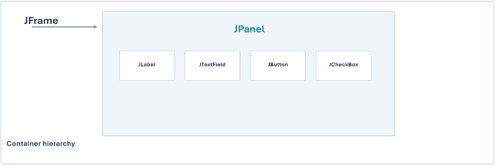

# JFrame and JPanel

- **JFrame** is the main application window. It includes the title bar, minimize button, and close button.
- **JPanel** is a container placed inside a `JFrame`. It holds components such as labels and buttons.

## Structure

```text
JFrame (main window)
└── JPanel (content area)
    ├── JLabel
    └── JButton
```



## Example code

```java
import javax.swing.*;
import java.awt.*;

public class FramePanelDemo {

    public static void main(String[] args) {

        // JFrame = the main application window
        JFrame frame = new JFrame("JFrame and JPanel Demo");
        frame.setSize(400, 250);
        frame.setDefaultCloseOperation(JFrame.EXIT_ON_CLOSE);

        // JPanel = a container placed inside the JFrame
        JPanel panel = new JPanel();
        panel.setBackground(Color.LIGHT_GRAY);

        // Components are added to the JPanel
        JLabel label = new JLabel("Welcome to Java Swing!");
        JButton button = new JButton("Click Me");

        panel.add(label);
        panel.add(button);

        // The JPanel is added to the JFrame
        frame.add(panel);

        // Show the window
        frame.setVisible(true);
    }
}
```

## How the program works

1. A `JFrame` named `frame` is created to serve as the application window.
2. A `JPanel` named `panel` is created with a light gray background.
3. A `JLabel` and a `JButton` are added to the panel.
4. The panel is added to the frame.
5. `setVisible(true)` displays the window.
